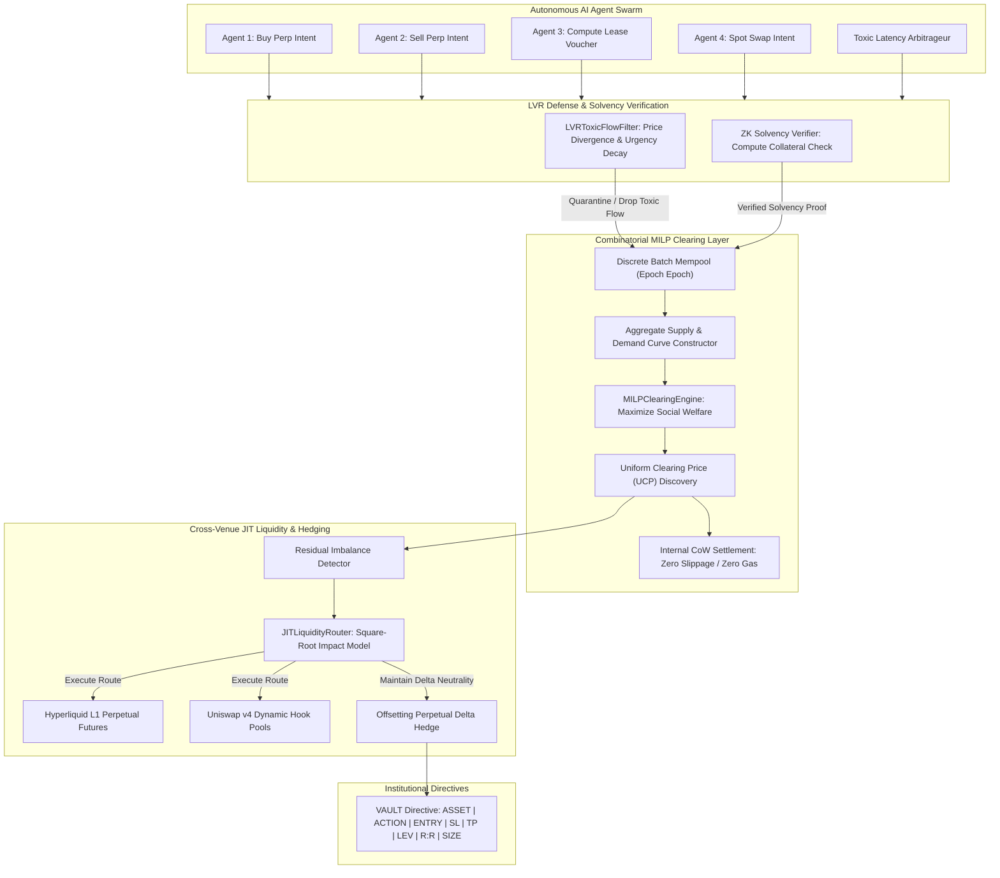

# Agent Intent Settlement (`agent-intent-settlement`)

[](https://www.python.org/downloads/)
[](https://opensource.org/licenses/Apache-2.0)
[](https://github.com/devsoniclk/agent-intent-settlement)
[](https://github.com/devsoniclk/agent-intent-settlement)
[](https://github.com/devsoniclk/agent-intent-settlement)

> **Autonomous Programmatic Intent Clearing & CoW-Batching Engine for Decentralized AI Agent Swarms.**  
> Combinatorial discrete batch matching, Uniform Clearing Price (UCP) equilibrium discovery, cross-venue JIT delta-neutral routing across Hyperliquid L1 and Uniswap v4, Loss-Versus-Rebalancing (LVR) defense, and cryptographic compute voucher solvency verification.

---

## 1. Overview & System Motivation

Autonomous multi-agent ecosystems (liquidity agents, arbitrageurs, compute schedulers, autonomous corporate treasuries) continuously emit high-frequency intents:
- Rebalancing liquidity provider positions.
- Delta-neutral perpetual basis trading.
- Dynamic leasing of GPU compute clusters and AI inference pipelines.
- Compute credit voucher rehypothecation.

### The Pitfalls of Continuous AMMs & Naive Solvers
1. **Catastrophic Loss-Versus-Rebalancing (LVR)**: Submitting continuous individual transactions directly to automated market makers exposes passive liquidity to informed arbitrageurs who exploit latency lags to extract value.
2. **MEV Sandwiches & High Slippage**: Autonomous agent transactions broadcast to public mempools suffer from frontrunning, backrunning, and sandwich attacks.
3. **Solver Directional Inventory Risk**: In asymmetric order flow, batch auction solvers are forced to absorb unbalanced volume. Without automated cross-venue delta hedging, solvers take on unhedged directional exposure.

### The Solution: Agent Intent Settlement
`agent-intent-settlement` provides a production-grade institutional clearinghouse:
- **Combinatorial CoW Matching**: Accumulates multi-agent orders in discrete blocks (5–15s epochs) and crosses overlapping buy/sell demand peer-to-peer at a single Uniform Clearing Price (UCP) with **zero price impact and zero L1 gas**.
- **Social Welfare Maximization**: Solves a Mixed-Integer Linear Program (MILP) maximizing cumulative trader surplus under All-or-None (AON) and partial fill constraints.
- **Cross-Venue JIT Delta-Neutral Rehypothecation**: Routes residual orderbook imbalances to the optimal venue (Hyperliquid L1 perps or Uniswap v4) while simultaneously placing offsetting perpetual hedges to preserve a strictly delta-neutral balance sheet.
- **LVR Adverse Selection Defense**: Evaluates incoming intents against volatility-adjusted toxicity metrics, filtering toxic latency arbitrageurs.
- **Cryptographic Solvency Verification**: Verifies zero-knowledge style solvency proofs for asynchronous compute credit leases.
- **Strict VAULT Directive Emission**: Translates hedge executions into standardized institutional directives (`ASSET | ACTION | ENTRY | SL | TP | LEV | R:R | SIZE`).

---

## 2. Architecture & Pipeline



---

## 3. Mathematical Foundations

### 3.1. Social Welfare Maximization
For a discrete batch of $N$ buy intents and $M$ sell intents, the clearing engine solves for Uniform Clearing Price $P^*$ that maximizes aggregate trader surplus:

$$\max_{P^*} \sum_{i \in \text{Buys}} (P_{\text{limit}, i} - P^*) \cdot q_i(P^*) + \sum_{j \in \text{Sells}} (P^* - P_{\text{limit}, j}) \cdot q_j(P^*)$$

Subject to:
$$\sum_{i \in \text{Buys}} q_i(P^*) = \sum_{j \in \text{Sells}} q_j(P^*)$$
$$0 \le q_k(P^*) \le Q_k, \quad \forall k$$
$$q_k(P^*) \in \{0, Q_k\} \quad \text{if } \text{min\_fill\_ratio}_k = 1.0 \text{ (All-or-None)}$$

### 3.2. LVR Adverse Selection Scoring
An intent is classified as toxic latency arbitrage if its normalized price divergence and urgency exceed the volatility threshold:

$$\text{Divergence} = \frac{|P_{\text{limit}} - P_{\text{fair}}|}{P_{\text{fair}}}$$
$$\text{Score} = \min\left( 0.60 \cdot \frac{\text{Divergence}}{\max(\sigma_{\text{intraday}}, 0.005)} + 0.40 \cdot \min(10 \cdot \delta_{\text{urgency}}, 0.40), 1.0 \right)$$

If $\text{Score} \ge \tau_{\text{toxic}}$ (default 0.70) or $\text{Divergence} > 1.5\%$, the intent is quarantined to protect passive liquidity.

### 3.3. Square-Root Market Impact & JIT Delta Hedging
Residual imbalance $Q_{\text{residual}}$ routed externally is priced using square-root slippage dynamics:

$$\text{Slippage (bps)} = \min\left( 30 \cdot \sqrt{\frac{Q_{\text{residual}} \cdot P_{\text{fair}}}{\text{Depth}_{\text{venue}}}}, 150 \right)$$

Simultaneously, an instantaneous offsetting perpetual position is opened on Hyperliquid L1:

$$\Delta_{\text{net}} = Q_{\text{residual}} - Q_{\text{hedge}} \equiv 0$$

---

## 4. Installation

```bash
git clone https://github.com/devsoniclk/agent-intent-settlement.git
cd agent-intent-settlement

# Install with development dependencies using uv or pip
uv venv
source .venv/bin/activate
uv pip install -e ".[dev]"
```

---

## 5. Quickstart: Python SDK

```python
from agent_intent_settlement import (
    AutonomousPerpetualIntentClearingStrategy,
    AgentIntent,
    IntentType,
    IntentDirection,
)

# Initialize master clearing strategy
strategy = AutonomousPerpetualIntentClearingStrategy(
    solver_fee_bps=2.0,
    jit_hedge_enabled=True,
    toxicity_threshold=0.70,
)

# Submit multi-agent intents
strategy.submit_intent(
    AgentIntent(
        intent_id="INT-BUY-01",
        agent_id="agent-alpha",
        asset="ETHUSDT",
        intent_type=IntentType.BUY_PERP,
        direction=IntentDirection.BUY,
        limit_price=3010.0,
        quantity=5.0,
    )
)

strategy.submit_intent(
    AgentIntent(
        intent_id="INT-SELL-01",
        agent_id="agent-beta",
        asset="ETHUSDT",
        intent_type=IntentType.SELL_PERP,
        direction=IntentDirection.SELL,
        limit_price=2995.0,
        quantity=3.5,
    )
)

# Process discrete batch auction
result = strategy.process_batch(
    batch_id="BATCH-001",
    asset="ETHUSDT",
    reference_market_price=3000.0,
    intraday_vol=0.02,
)

print(f"Uniform Clearing Price: ${result.clearing_price:.2f}")
print(f"CoW Matched Volume: {result.matched_cow_volume} ETH")
print(f"Trader Surplus: ${result.total_trader_surplus_usd:.2f}")
print(f"LVR Mitigated: ${result.lvr_mitigated_usd:.2f}")
print(f"Solver Captured Profit: ${result.solver_profit_usd:.2f}")
```

---

## 6. CLI Usage

The package exposes the `agent-intent` command-line suite:

### 6.1. Solve a Batch Auction
```bash
agent-intent solve --asset ETHUSDT --price 3000.0 --intents 20
```

### 6.2. Run Multi-Epoch Monte Carlo Simulation
```bash
agent-intent simulate --asset SOLUSDT --epochs 10 --intents-per-epoch 30 --start-price 185.0
```

### 6.3. Generate Institutional VAULT Directive
```bash
agent-intent directive --asset ETHUSDT --action SHORT --price 3000.0 --atr 45.0 --size "5.0 ETH" --leverage 2.0
```
Output:
```text
ETHUSDT | SELL | 2998.5000 | 3070.5000 | 2847.3000 | 2.0x | 2.1:1 | 5.0 ETH
```

### 6.4. Launch Stdio MCP Server
```bash
agent-intent mcp
```

---

## 7. Model Context Protocol (MCP) Tools

When connected via JSON-RPC 2.0 stdio, the following tools are available:

| Tool | Parameters | Description |
|---|---|---|
| `submit_intent` | `agent_id`, `asset`, `direction`, `limit_price`, `quantity`, `intent_type`, `min_fill_ratio`, `urgency_decay` | Queue trading or compute lease intent into the mempool |
| `solve_batch` | `batch_id`, `asset`, `reference_market_price`, `intraday_vol`, `hl_depth_usd`, `uni_depth_usd` | Solve discrete batch auction, filter toxic flow, and route residuals |
| `evaluate_toxicity` | `direction`, `limit_price`, `quantity`, `fair_market_price`, `intraday_vol`, `urgency_decay` | Calculate intent toxicity score and LVR risk |
| `verify_solvency` | `agent_id`, `credit_voucher_usd`, `required_collateral_usd`, `proof_hash` | Verify zero-knowledge compute voucher solvency proof |
| `generate_vault_directive` | `asset`, `action`, `current_market_price`, `atr_14`, `size_str`, `leverage`, `direction` | Emit strictly formatted VAULT execution directive |
| `simulate_clearing_epochs` | `asset`, `num_epochs`, `intents_per_epoch`, `start_price`, `volatility`, `toxic_ratio` | Run Monte Carlo discrete auction benchmark |

---

## 8. Verification & Test Suite

All algorithms are covered with exhaustive unit and integration tests:

```bash
uv run --extra dev pytest tests/ -v --cov=agent_intent_settlement
```

---

## 9. License

Apache-2.0 License. See [LICENSE](LICENSE) for details.  
Maintained by Lakshitha Dananjaya ([devsoniclk](https://github.com/devsoniclk)).
